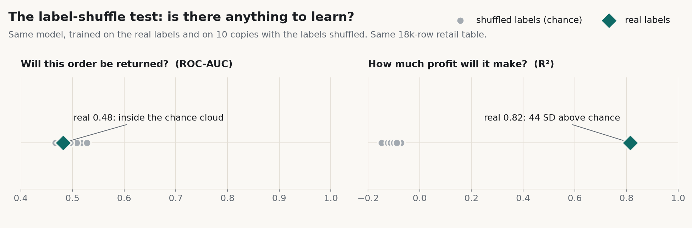
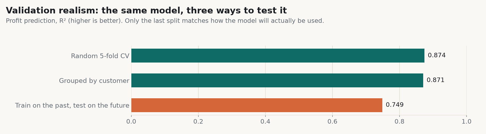

Most ML projects start by training a model. When the score is bad, the usual next step is a bigger model, more tuning, more epochs. Sometimes the problem is not the model at all: **the data can't support the question being asked.**

I wanted a tool that answers that question *before* training. So I built **[Dr.Data](https://github.com/Zephyr4772/Dr.Data)**: you give it a table and a use case (the target, what a mistake costs, when you'll be predicting, which columns you won't have at that moment), and it tells you whether the data is fit for that use case, and if it is, how to train on it.

The catch is that fitness depends on the question: **the same table can be fine for one use case and useless for another.**

**The short version:**

- One 18,000-row retail table scores **60/100 for predicting profit** (strong signal, but a hidden formula leak) and **30/100 for predicting returns** (no signal at all: the real labels score *worse* than shuffled ones).
- On a public medical dataset I sabotaged on purpose, it **recovered every planted defect**: the leaky column, the duplicates, the ID, the constant column, the copied column, the missing values, the misspelled class, and the label noise.
- For profit, a normal random cross-validation says **R² 0.87**. Training on the past and testing on the future says **0.75**. Only the second number is what you'd see in production.
- Each audit takes **18 to 38 seconds** on a laptop CPU.

## What "fit for the use case" means

Data-quality tools usually check the table on its own: missing values, outliers, types. Those matter, but they don't tell you whether *your* model will work. That depends on what you want to do with the data:

- **What are you predicting, and what does a mistake cost?** Catching every malignant biopsy calls for recall-weighted F2 and a tuned threshold. Forecasting profit with no big misses calls for RMSE.
- **When will you predict?** A column that's only filled in after the outcome (a delivery delay, a customer rating) is fine for analysis and poison for a model that runs at checkout.
- **Will the model see the future or the past?** If you're predicting next month, a random split lets the model peek at next month during training.
- **Who is it for?** A model can be fine on average and poor for one region.

So Dr.Data asks for those things up front, and every check uses them.

## What it runs

About 200 model fits per audit, in this order. Each stage only runs on what the previous ones left clean:

1. **Profile and hygiene.** Real column types (numbers stored as text, dates, IDs, personal data), duplicates, spelling variants, impossible values, and columns that are exact formulas of other columns.
2. **Leakage.** How well does each column predict the target *on its own*? Is the target an exact formula of other columns? Do any names suggest "recorded after the outcome"? Leaks are removed before anything else is measured.
3. **Signal: the label-shuffle test.** Train the same model on the real labels and on 10 copies with the labels shuffled. If the real score sits inside the cloud of shuffled scores, there's nothing to learn and the audit stops recommending models.
4. **Validation realism.** The same model scored with random CV, with time-ordered CV (train on the past, test on the next period), and grouped by entity (no customer in both train and test).
5. **A model bake-off.** Six model families on identical folds. The pick uses the **one-standard-error rule**: if a simpler or smaller model is within noise of the best, take it. Interpretability and deployment limits (an edge device needs <2 MB and <1 ms) go into the choice.
6. **Subgroups, data size and labels.** Per-group error, a fitted learning curve (would more rows help?), and a confident-learning pass that lists rows whose labels look wrong.
7. **A plan.** Loss curves from short real training runs, a fit-time estimate, ordered next steps, and generated scikit-learn starter code.

The result is a **fitness score** out of 100, built from penalties per finding, with two hard caps: **60** if the raw data leaks the target, **30** if there's no learnable signal. Every finding comes with what was measured, why it matters for *this* use case, and what to do about it.

## Test 1: can it find defects I planted?

I took scikit-learn's breast cancer dataset (569 biopsies, 30 features), which is clean, and broke it in eight ways. Then I ran both versions with the same use case: *screen biopsies for malignancy; missing a malignant case is costly.*

The clean version scores **97, "fit for purpose"**: the best model reaches F2 0.959 against 0.748 for a model that guesses "malignant" every time. The sabotaged version scores **60, "usable after fixes"**:

| What I planted | What Dr.Data reported |
|---|---|
| `biopsy_result_score`, a column derived from the diagnosis | **Critical:** predicts the target alone (skill 0.79) and its name says it's recorded after the outcome ("result"). Removed before modelling. |
| 10% of rows duplicated | 57 exact duplicates (9.1%), which "also explain all 57 repeated values of `patient_id`". Dropped before splitting. |
| A `patient_id` column | Excluded as an identifier. |
| `scanner_flag`, the same value in every row | Flagged as constant. |
| `mean radius (mm)`, a near-copy of `mean radius` | Flagged as a redundant pair (r = 1.00). |
| 30% of `mean texture` deleted | "31% empty." |
| 3% of labels respelled `"Malignant "` | A spelling variant of `malignant` (16 values). |
| Flipped labels: 44 rows (7.7%) end up with the wrong diagnosis | "About 6.5% of labels look wrong" (37 rows). **14 of the 15 rows it lists are real flips.** |

Two things I didn't expect. First, the leak: with `biopsy_result_score` in, any model looks nearly perfect, and that's exactly the kind of result that gets published. Second, the cost of the damage that *isn't* a leak: after Dr.Data removes the leak, the best model gets F2 0.833, only 23% of the way from the no-skill baseline to perfect, compared with 84% on the clean data. The label noise and lost values are doing that.

## Test 2: one table, two use cases

The second test is the one that made me build this. It's a messy 18,045-row retail table: orders with products, prices, discounts, customers, regions, a profit column and a return flag. Both use cases come from the same file.

### Predicting returns: 30, "not fit for this use case yet"

The model scores ROC-AUC **0.482** on the real labels. With the labels shuffled, it scores **0.505 ± 0.016**. The real labels do *worse than chance*. All six models fail to beat the no-skill baseline on F2 (best 0.286 vs 0.367).

The accuracy trap is right there too: 89.6% of orders aren't returned, so a model that always says "no" scores 89.6% accuracy and catches zero returns.

The report's conclusion: *"Training a bigger model, more epochs or fine-tuning would only memorise noise. The next step is new information, not a new algorithm."* I think this is the most useful thing the tool says. The fix for returns is collecting something that actually relates to returns (size, product reviews, the customer's return history), not a better model.

I also declared `Customer_Rating` and `Delivery_Days` as *not known at prediction time*, because you're predicting at checkout. Dr.Data excludes them. Leave them in and the problem looks easier than it is.

### Predicting profit: 60, "usable after fixes"

Here there's plenty of signal (R² 0.82 vs about −0.1 for shuffled labels, 44 standard deviations apart). But the leakage check finds this:

> `Profit = Sales_Amount − Cost_Amount` holds exactly for 99.4% of rows. It is violated by 106 rows (0.6%), which are most likely data-entry errors.

If you have sales and cost at prediction time, you don't need ML: just subtract. If you don't, those columns are leaks. Either way they come out. The formula search is robust to the broken rows (it looks for the formula that holds for most rows, not all of them), and the 106 rows that break it are reported as probable data errors.

With the leak removed, the next problem is how you test:

Random 5-fold CV mixes future orders into training. Training on the past and scoring the next period drops R² from **0.874 to 0.749**, and the mean profit per order drifts from 111.8 to 77.1 over the period. Grouping by customer barely changes anything (0.871), so the model isn't memorising customers. That's the check passing, and it's worth knowing.

The bake-off then shows the one-standard-error rule in action. Random forest has the lowest error (MAE 19.8), but gradient boosting (20.9) is within one standard error, **19× smaller** (689 KB vs 12.9 MB) and **10× faster** per prediction. The recommendation is gradient boosting.

A few other findings from the same run:

- **The model is weaker for one region**: MAE 30.8 for Bavaria (291 orders) vs 20.9 overall.
- **More data would still help**: the fitted learning curve predicts about 25% lower error if the training rows double.
- **The usual mess**: `Female`/`FEMALE`, `New York`/` New York `, a customer aged 4 and another aged 112, negative quantities, a 110% discount.

## What I learned building it

- **Shuffled labels are the cheapest sanity check in ML**, and almost nobody runs them. Ten extra fits tell you whether a 0.6 AUC means "weak signal" or "nothing".
- **Leak detection needs the use case.** `Delivery_Days` is not a leak in a table; it's a leak *in a model that runs at checkout*. A tool can't know that without being told when predictions happen.
- **Random CV is the default and often the wrong one.** For anything with a time column, test on the future.
- **"Not fit" is a valid answer.** The most valuable verdict is often the one that tells you to stop training and go get different data.

---

**Caveats:** it's built for tabular data up to a few hundred thousand rows (model-based checks use a representative sample of at most 5,000 rows). The fitness score is a summary of weighted penalties, not a calibrated probability; read the findings, not just the number. The breast cancer sabotage is my own, so it tests the defects I thought to plant.

*Code, the demo datasets and a run guide: [github.com/Zephyr4772/Dr.Data](https://github.com/Zephyr4772/Dr.Data). It runs locally: `py -3 server.py`, then open the browser.*
